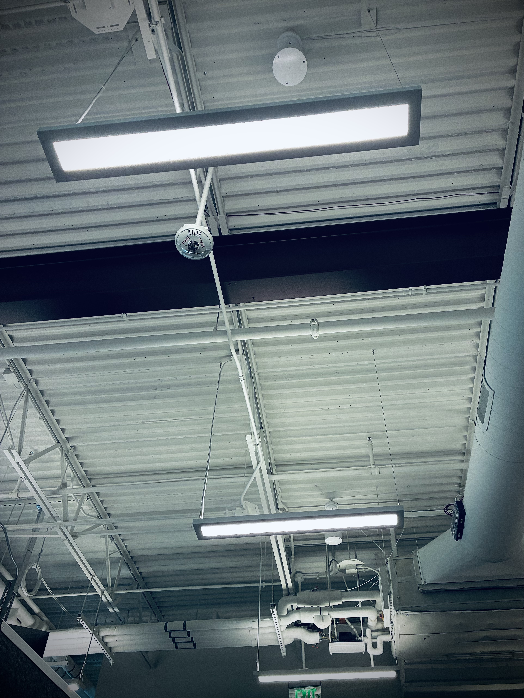

Look around the room and notice.

We sit beneath these cold fluorescent bulbs, faintly humming like bees in a hive, mindlessly chasing the satisfaction of the collective.

Stale coffee and anxious sweat fill the air. Everyone is in a panic, but when everything is urgent, nothing is.

Through the window, sunlight warms the garden. A breeze carries the subtle scent of flowers. Life is happening just outside.

I’m stuck in a locked cage, but only I hold the key.
